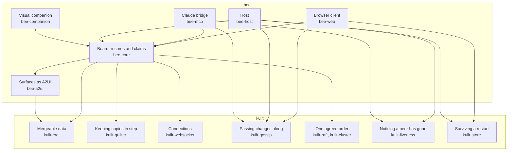

# bee and kuilt

bee is a board that many people and agents share at once. Each of them holds their own copy, and
every copy has to stay in step: through flaky Wi-Fi, a laptop lid closing, a Claude session that
crashes halfway through a task. That's a hard problem, and boards aren't special in having it. A
multiplayer game has it, and so does a shared to-do list.

[kuilt](https://github.com/tractat-us/kuilt) is the library that solves it. bee is everything that
makes the result a board.

Where a piece goes comes down to one question: **could an app that isn't bee want this?** If so,
it belongs in kuilt. If it's about the board, the people at it or the agents drawing on it, it's
bee's.

## What kuilt does for bee

kuilt comes as a set of small libraries, called modules, and bee uses nine of them. Each one does a
job bee would otherwise have to build.

| The job | kuilt module |
|---|---|
| Hold a copy of the board that merges with any other copy | `kuilt-crdt` |
| Send each change to every other copy, and catch up a copy that was away | `kuilt-quilter` |
| Carry those changes over the network | `kuilt-websocket`, `kuilt-gossip` |
| Make sure exactly one peer takes a task | `kuilt-raft`, `kuilt-cluster` |
| Notice that a Claude session has gone | `kuilt-liveness` |
| Keep the board through a restart or a reload | `kuilt-store` |
| Test all of it without a real network or a real clock | `kuilt-test` |

A few ideas sit under those jobs, and each is worth naming once.

- **A copy that always merges.** Each copy of the board is a *CRDT*: a data structure where any two
  copies can be merged, in any order, and always reach the same result. Each thing on the board,
  such as a poll or a set of cards, is a *surface*, and each surface is one of kuilt's `JsonCrdt`
  documents. The clicks waiting to be handled are a kuilt `Rga`, an ordered list that merges the
  same way.
- **Exactly one winner.** When someone says "I'll take this card", there must be one winner, and
  merging can't promise that: two peers that can't see each other can both claim the same card.
  So a *claim* goes through a vote instead. kuilt's *Raft* puts every claim into one agreed order,
  and bee gives the card to the first claim in that order. In v1 the bee host is the only voter.
  Browsers and Claude sessions are *learners*: they follow the agreed order and send their claims
  to the voter, which never claims anything itself.
- **Who's here.** Presence, the list of who's attached right now, is a kuilt `EphemeralMap`. Each
  peer keeps one entry fresh, and an entry fades once its peer stops checking in.

## What bee owns

Everything that makes it a board for people and their agents:

- **The browser client** (`bee-web`). A copy of the board that runs inside the web page, compiled
  to WebAssembly, so any browser can join with nothing installed. Its driver turns the board into
  messages for the stock A2UI renderer, and turns clicks back into edits. A2UI is the open format
  bee uses to describe what goes on screen.
- **The bridge** (`bee-mcp`). One per Claude session. It holds that session's copy of the board
  and gives the agent its tools: draw on the board, wait for a click, claim the work
  ([Tools and prompts](tools.md)). It also handles the session's lifecycle, including `/clear`.
- **The host** (`bee-host`). The one piece that's always on. It relays changes between everyone,
  keeps a copy on disk, casts the vote on claims, and serves the web page.
- **The shared core** (`bee-core` and `bee-a2ui`). The board's shape, the records of who clicked
  what, the claims, and how a surface maps onto A2UI. The browser client, the bridge and the host
  are all built on it.
- **The catalog** (`bee-notions`). bee's own set of on-screen components: A2UI's basic ones,
  plus `Poll`, `Board` (cards in columns) and `Sketch`, which runs agent-written HTML in a sandbox.
- **The visual companion** (`bee-companion`). The brainstorming companion, running on the board
  through `Sketch`.
- **The rules.** Who may put what on the board, who may let a new screen in, and where bee runs.

The phone app, a thin frame around the web client, comes after v1 and is bee's too.

## How the pieces stack

Each arrow reads "is built on".

The mergeable data, keeping copies in step, the connections and the agreed order reach the
browser client, the bridge and the host through `bee-core`. Each of the three adds gossip itself, plus whichever of liveness and
storage it needs. `bee-a2ui` needs only `kuilt-crdt`, which matters in the next section.
`bee-notions` uses no kuilt at all: it's the renderer's side of the page.

## Why the line sits where it does

Several of the pieces bee needs have nothing to do with boards. Exactly-once claims, a voter
that never claims for itself, records of a click that remember what the clicker could see,
surfaces stored as JSON on a CRDT: another app could want any of them.

So bee builds each one first, because bee is where it's needed, and builds it without leaning on
anything bee-specific. Once a piece has proven itself in bee, it moves to kuilt through a kuilt
pull request. `bee-a2ui` shows the shape: it depends on `kuilt-crdt` and nothing else, so it can
move whole. Whether it should is still an open question.

The design spec's [kuilt section](superpowers/specs/2026-11-06-bee-design.md#7-bee-and-kuilt) lists
what may graduate and what stays.

## When bee needs something kuilt lacks

bee never patches kuilt, copies its code in, or quietly works around it. A gap becomes an issue in
kuilt's tracker, and a kuilt session, a separate Claude Code session working in kuilt, picks it
up. If bee can't wait, its workaround carries a comment naming the issue, so it's easy to find and
remove once kuilt catches up.

Two gaps show the loop.

- **A second learner pushed out the first.** bee's claims spike raced two clients for one card.
  When the voter let the second learner in, it dropped the first, which then never saw its own
  claims succeed ([bee#11](https://github.com/tractat-us/bee/issues/11)). bee could have routed
  every claim through a proxy of its own. Instead it chose to fix kuilt first
  ([kuilt#3120](https://github.com/tractat-us/kuilt/issues/3120)), and the fix shipped in kuilt
  `0.7.0-dev.1692`. A follow-up gap, a learner that had gone never being removed
  ([kuilt#3127](https://github.com/tractat-us/kuilt/issues/3127)), was fixed in `0.7.0-dev.1693`.
  bee took it by changing its kuilt version and re-enabling the test that proves it, with no
  other code change ([bee#26](https://github.com/tractat-us/bee/pull/26)). The
  [spike notes](spikes/2026-11-spike-4-claims.md) tell the whole story.
- **Removing a key lost its history.** In kuilt's JSON CRDT, deleting a key and writing it again
  could reuse identities other copies had already seen, so a concurrent edit could silently erase
  the new value ([kuilt#3126](https://github.com/tractat-us/kuilt/issues/3126)). bee's surface
  code never deletes a key. A workaround that clears values instead
  ([bee#19](https://github.com/tractat-us/bee/pull/19)) worked, but it couldn't tell a cleared
  object from an empty one. So it's on hold until kuilt's fix lands and bee can delete outright.
  In November 2026 that fix is a kuilt epic still in progress.

bee's open asks are collected on one kuilt tracking issue,
[kuilt#3119](https://github.com/tractat-us/kuilt/issues/3119). The plan lists the gaps known when
it was written, under
[kuilt tracking-issue items](superpowers/plans/2026-11-06-bee-v1.md#kuilt-tracking-issue-items).
kuilt's issues describe each gap on its own terms and don't name bee, because kuilt is public and
its policy, for now, is not to reference other `tractat-us` projects
([spec §11](superpowers/specs/2026-11-06-bee-design.md#11-follow-ups-outside-bee)).

## How bee gets kuilt

bee builds against published kuilt dev builds, fetched as packages by their Maven coordinates
rather than built from kuilt's source. They come from tractat-us's own private package store, so a
build needs its credentials. A single version number, `kuilt` in `gradle/libs.versions.toml`, lines
up every kuilt module bee uses, so moving to a new kuilt build is a one-line change.

To work on both at once, put a kuilt checkout beside bee's, at `../kuilt`. Gradle then builds bee
against that checkout instead of the published build, which is called a *composite build*. The
switch is one line in `settings.gradle.kts`:
`if (file("../kuilt").exists()) includeBuild("../kuilt")`. CI and agents working in their own
worktrees have no checkout beside them, so they always build against the published build.

## A paused kuilt project bee borrows from

[kuilt#2869](https://github.com/tractat-us/kuilt/issues/2869) explores shared workspaces for
people and agents. It's paused, and bee is separate from it. bee borrows its rule for records: a
result keeps a record of what it was based on, so a click can never later look as though it saw
something it hadn't. The plan's
[checkpoint](superpowers/plans/2026-11-06-bee-v1.md#kuilt2869-checkpoint-after-the-plan) lists what
bee took and what kuilt#2869 might take back, and the spec's
[section on it](superpowers/specs/2026-11-06-bee-design.md#8-bee-and-kuilt2869) says why the two
stay apart.
