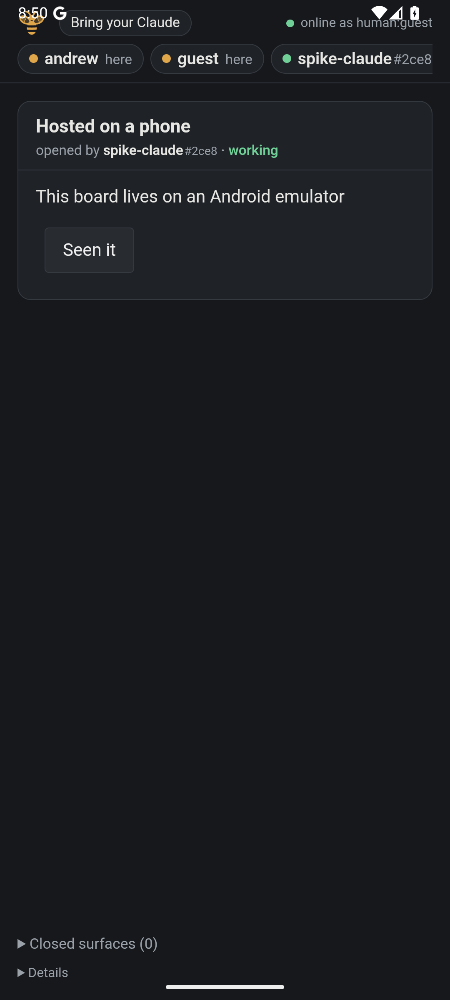

# Spike: a phone that hosts a bee board

The question was whether a phone can host a bee board that a laptop browser and a laptop Claude
session on the same Wi-Fi join. The idea is a small "bee app" that opens straight onto a
whiteboard and hosts it.

**On Android, yes, and today's bee-host runs almost unchanged.** It runs in-process in a
throwaway Android app, unmodified apart from three one-line fixes for Java APIs that Android
lacks. A laptop browser and a laptop Claude session joined the phone's board, drew on it and
clicked it, and each side saw the other's changes. **On iOS, not yet.** Ktor's server compiles
for iOS, but kuilt's WebSocket server half and the MCP server SDK don't ship for iOS, and
bee-host is JVM-only code. That makes iOS a port, not a wrapper.

The recommendation is to build the Android app first, as a few weeks of work, and to treat iOS as
a separate decision behind one kuilt change and one SDK gap.

The spike's code is on the `spike/bee-app` branch (Draft PR #154, never merged):
`spike/bee-app/` is the Android app and `spike/ios-probe/` is the iOS compile probe. The
bee-host edits are marked `SPIKE`.

## What was run on Android

The app is one Activity. It starts `BeeHost.start` on port 8233 with its data under the app's
`filesDir`, and its whole screen is a WebView of `http://127.0.0.1:8233/`. bee-host comes in as
the jars of `:bee-host:installDist`, with no source changes beyond the fixes below. The app was
built with AGP 9.2.1 and run on an API 36 emulator (WebView 147). The emulator's port was
reached through `adb forward tcp:8233 tcp:8233`.

| Check | Result |
|---|---|
| The host starts in-process | **Yes.** It is up in 0.7–3.3 s: 686 ms in the R8 release build, 1–3 s in debug. |
| The phone's own WebView shows the board | **Yes.** The wasm page loads from the APK's resources and joins as `human:guest`. |
| (a) A laptop browser joins, and changes cross both ways | **Yes.** Playwright on the laptop saw the surface a Claude drew. A "Seen it" click from the laptop and a tap on the phone each reached the host as an action record, read back over MCP. |
| (b) `POST /mcp?name=x` with `initialize` answers | **Yes.** It returned 200 with an `mcp-session-id` and the bee instructions. |
| (c) `claude -p` draws through the phone | **Yes.** It used `claude mcp add --transport http --scope local bee 'http://127.0.0.1:8233/mcp?name=spike'` in a scratch dir, opened `phone-spike`, and the phone showed it (the screenshot above). The MCP entry was removed afterwards. |
| The board outlives a restart | **Yes.** `java.nio.file` under `filesDir` works, and a relaunch restored the surfaces and records. |
| A peer off loopback needs a key | **Yes.** Through an emulator `redir`, a call from `10.0.2.2` got a 403 on `/mcp` without a key and a 200 with the join link's `k=`. |
| The join link | **Numeric, yes; named, no.** `/invite` gave `http://10.0.2.15:8233/?k=…`, but its `.local` name came out as `localhost.local`. |
| Backgrounded with no service | **Frozen after about 60–120 s.** The host answered at 60 s, timed out at 120 s, and `dumpsys` showed `isFrozen=true` (the cached-app freezer). It thawed and answered again on return. |
| Backgrounded with a foreground service | **Still answering at 120 s**, with **no notification shown**, because the app never asks for `POST_NOTIFICATIONS`. |
| APK size | 29 MB debug. 12.6 MB with R8 and generous keeps, of which 3 MB is `bee.js.map`. An R8 build still hosts and serves MCP. |

### What broke, and what it would take

Every break was a Java API newer than Android's runtime. D8 accepted bee's Java 25 bytecode
(class version 69) without complaint, so each one surfaced only at run time, as a
`NoSuchMethodError` or `NoClassDefFoundError` on the first call.

| Break | Where | Spike patch | Real fix |
|---|---|---|---|
| `java.lang.ProcessHandle` | `DataDirLock.take` writes the pid | Catch it and write `-1` | A phone needs no cross-process lock: the app sandbox owns the dir. |
| `InetAddress.ofLiteral` (Java 22) | `SiteRule`, `isLoopback` | `getByName` on a string that is already a literal | A small parser in common code, or `InetAddresses.parseNumericAddress` on Android. |
| `NetworkInterface.networkInterfaces()` (Java 9 streams) | `lanAddresses` | The `Enumeration` forms | The same, which works on both. |

The structural fix is to let the compiler catch this class of break. Give bee-host an Android
target, with JVM and Android sharing a `jvmAndAndroidMain` the way kuilt-websocket does, so that a
JDK-only API fails the Android compile instead of the first call.

Other things the spike recorded:

- **Netty runs on Android** once its `epoll` and `kqueue` *class* jars stay in, because Ktor
  probes them. It logs two harmless warnings about direct buffers and the MAC address. kuilt's
  own Android server uses CIO, which is the lighter choice for a real app, but nothing forces it.
- **Logback works**, writing through `System.err` into logcat. A real app would bind SLF4J to
  logcat instead.
- **Page assets from the APK work.** `staticResources("/", "web")` serves from Java resources
  merged into the APK. The only packaging fix was picking one of two `logback.xml` files, bee-mcp's
  and bee-host's.
- **The loopback-owner rule is wrong on a phone.** The phone's WebView is on loopback and needs no
  key, which is right for it. But every other app on the phone is on loopback too, and so is
  anything arriving through `adb forward`. A native app can forge any header, so `SiteRule` doesn't
  stop one. On a laptop, another local process is already inside the trust boundary. On a phone,
  another app is not. A phone host should require a key on loopback too, and hand its own WebView
  that key.
- **The named join link needs mDNS.** Android's `InetAddress.getLocalHost()` is `localhost`.
  The app would register itself with NSD, or kuilt-mdns, which ships an Android variant, or it
  would drop the named link.
- **An `adb forward` on 8233 collides with the laptop's own host port.** Open laptop tabs at
  `localhost:8233` reloaded onto the emulator's board. Use another port during development.

## iOS: desk research and one compile probe

| Piece | Ships for iOS? | Evidence |
|---|---|---|
| Ktor server: `ktor-server-cio`, `-websockets`, `-sse` 3.6.1 | **Yes** | They are on Maven Central as `-iosarm64` and `-iossimulatorarm64`. `spike/ios-probe` compiles a CIO server with a WebSocket route and an SSE route by `compileKotlinIosSimulatorArm64`. |
| bee-core, bee-a2ui | **Yes, unchanged** | `:bee-core:compileKotlinIosSimulatorArm64 -PspikeIos` passes, through an opt-in iOS target added on the branch. |
| kuilt crdt, quilter, cluster, raft, gossip, liveness, store, websocket (client) | **Yes** | `0.7.0-dev.1696` publishes `-iosarm64` and `-iossimulatorarm64` artifacts. |
| kuilt-websocket's server half: `KtorRoomHost`, `KtorConnectionSource`, `KtorServerLoom` | **No: a kuilt gap** | They live in `jvmAndAndroidMain`. With `-Pkuilt`, the probe fails with `Unresolved reference 'KtorRoomHost'`. kuilt's build comment says Ktor's server core has no native variant, which is out of date for 3.6.1. The code has no `java.*` imports outside `tls/`. |
| kuilt-nw | Yes, but it doesn't help | It is Network.framework TCP with a pre-shared key, which a browser can't speak. |
| MCP server SDK (`kotlin-sdk-server` 0.16.0) | **No** | Maven Central lists JVM, JS, wasm, Linux, macOS and Windows. The client and core modules do ship for iOS. |
| bee-host itself | **No** | About 2,600 lines of JVM code: `java.nio.file`, `FileChannel` locks, `SecureRandom`, `MessageDigest`, `InetAddress`, `staticResources` from the classpath, and Logback. Each one needs a common replacement or an `expect`/`actual`. |

So an iOS host needs four things. The first is a kuilt PR that moves the server half to a source
set that includes Apple targets. The second is bee-host as Kotlin Multiplatform. The third is an
answer for `/mcp`: wait for the SDK, hand-write Streamable HTTP, or have the laptop run the bridge
from the kit and dial the phone's board. The fourth is an iOS shell around a WKWebView. On top of
that, iOS suspends a backgrounded app's sockets, so the host lives only while the board is on
screen.

**Not filed:** the kuilt-websocket server gap is a kuilt issue to file if iOS goes ahead. Filing
it now would ask kuilt for work nobody has chosen to do.

## The product read

**Keep the screen on, and the hosting needs nothing visible.** A board on a table is a screen
that stays lit, so `FLAG_KEEP_SCREEN_ON` while the board is up costs no chrome. It also sidesteps
Doze, which this spike didn't measure with the screen off. For the moments the phone does go to
the background, a `specialUse` foreground service keeps the host thawed. Every permission it
needs is granted at install, without a prompt. Because the app never asks to post notifications,
Android 13 and later show nothing in the shade: the service appears only in the system's list of
running services. The cost moves off screen: Play asks a `specialUse` app for a written
justification, and a release ships through review. On iOS the board is on screen or it is gone,
and the iOS 14 local-network prompt is likely the one unavoidable dialog.

**Battery** is dominated by the lit screen. The host itself idles on a few sockets. That wasn't
measured on hardware here.

**Wi-Fi client isolation** is the wall a phone can't climb alone. Guest and office networks often
block one client from reaching another, and the board then works only for the phone's own
WebView. The low-clutter fallback is the phone's own hotspot: the laptop joins it, and the phone
is the gateway. That's one step for whoever joins and nothing on the board.

**Finding the phone from the laptop.** The invite QR from #129 already exists. Keep it hidden and
show it on demand, for example on a tap of the bee mark, never as a standing button. A phone can
scan it; a laptop can't. A laptop browser instead opens the numeric address and pairs with a code,
as LAN pairing already works. The laptop's Claude then gets its line from that browser's "Bring
your Claude". The step that removes typing altogether is the phone advertising itself over mDNS,
through kuilt-mdns, so that `bee-join` or the plugin finds it by name.

**The page's own chrome is the clutter.** In the WebView, the board page brings its desktop bar:
"Bring your Claude", the presence chips, "online as human:guest", "Closed surfaces" and
"Details". With Android's edge-to-edge default, the bar also draws under the status bar. An app
should load the page in a board-only mode: no bar, safe-area insets, presence as small dots at
most, and the QR on demand. It should also name its owner from the device's name, never with a
prompt.

## Cost of a real app

These are rough estimates from what broke here, not a plan.

- **Android: about 2 weeks.**
  - Give bee-host an Android target and fix the three APIs properly: 1–2 days.
  - Add an app module to bee's build with a WebView shell, keep-screen-on and the silent
    service: 2 days.
  - Require a key on loopback, with the WebView holding it: 1 day.
  - Add the board-only page mode: 2–3 days.
  - Advertise over mDNS and fix the named link: 1–2 days.
  - Set up signing, CI and the Play `specialUse` review: 2 days, plus review time.
- **iOS: about 4–6 weeks after Android.**
  - Move the kuilt server half to Apple targets: a kuilt PR.
  - Make bee-host Kotlin Multiplatform: 1–2 weeks.
  - Answer `/mcp`: about 1 week, or less if the laptop runs the bridge.
  - Build the WKWebView shell: about 1 week.
  - Live with foreground-only hosting.

## Recommendation

Build the Android app as the first bee app. The host already runs there, and the open work is
product polish and the loopback key, not porting. Before starting it, decide the loopback rule:
a phone host must not trust every app on the phone. Leave iOS until Android shows that people
want a phone-hosted board. Then file the kuilt server-on-Apple issue first, since everything else
on iOS waits on it.
